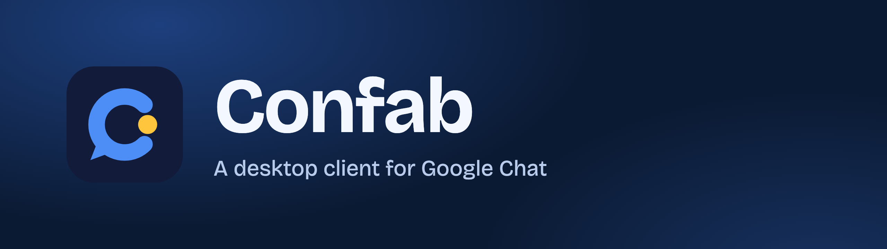
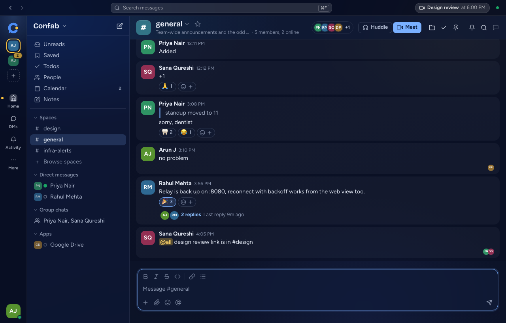
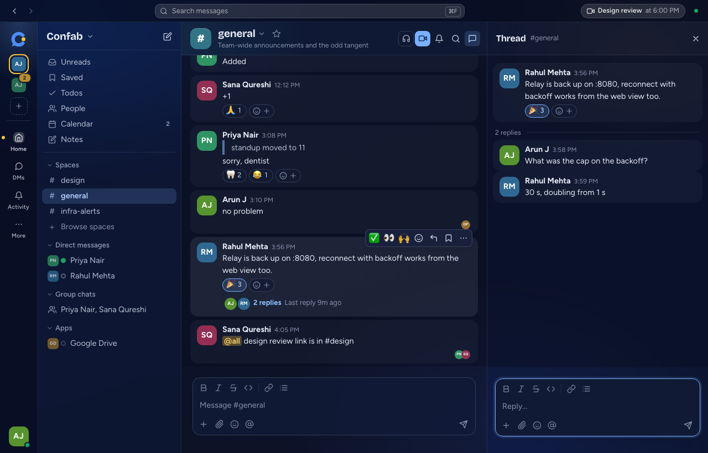
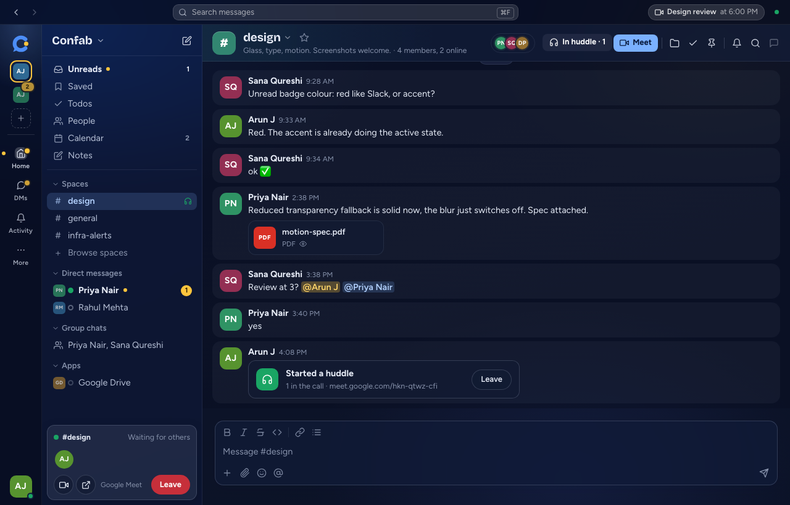
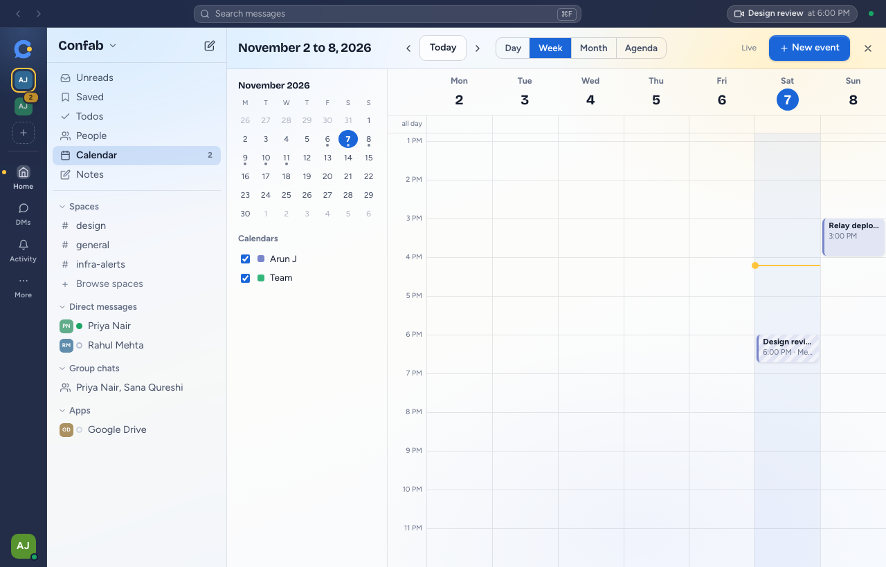
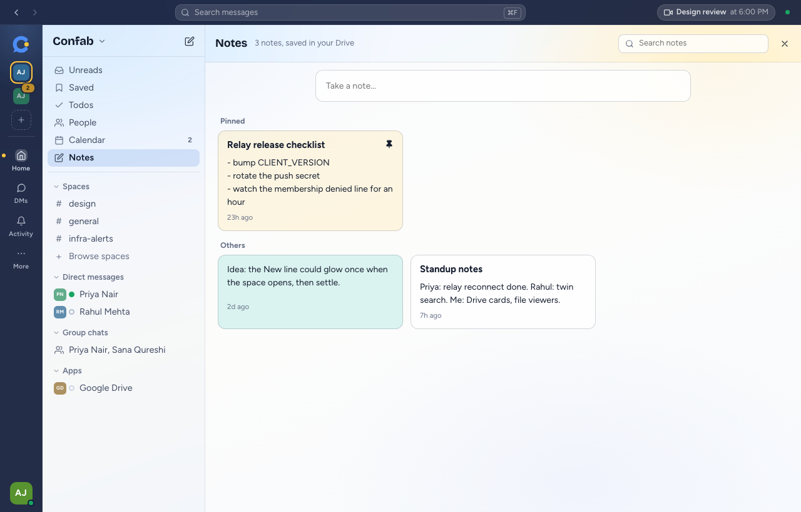

<p align="center">
  
</p>

<h1 align="center">Confab: a desktop client for Google Chat</h1>

<p align="center">
  <b>Your Google Chat, in a fast desktop app with a layout that stays out of your way.</b><br>
  Same account, same spaces, same messages. A much nicer place to read them.
</p>

<p align="center">
  
  
  
  
  
  <a href="LICENSE"></a>
  
</p>

<p align="center">
  <a href="#google-chat-desktop-app-features">Features</a> &nbsp;&nbsp;
  <a href="#run-confab-locally">Run it</a> &nbsp;&nbsp;
  <a href="#connect-your-google-workspace-account">Connect Workspace</a> &nbsp;&nbsp;
  <a href="#roadmap">Roadmap</a> &nbsp;&nbsp;
  <a href="#faq">FAQ</a> &nbsp;&nbsp;
  <a href="docs/ARCHITECTURE.md">Architecture</a>
</p>

<br>



## What is Confab?

Confab is an unofficial, open source desktop client for [Google Chat](https://workspace.google.com/products/chat/) and Google Workspace, built with Tauri, Rust and React. You sign in with your Workspace account and it talks to Google's own APIs, so spaces, direct messages and threads stay in sync with Chat on the web and on your phone. Google Meet huddles, Google Calendar, Google Tasks and notes sit in the same window. Nobody else on your team has to install it.

## Google Chat desktop app features

<table>
<tr>
<td width="50%" valign="top">

### Spaces, direct messages and threads
Spaces, DMs and group chats in one sidebar. Threads open in a side panel, and messages from the same person group into one clean block. Press `⌘K` to jump anywhere.

</td>
<td width="50%">



</td>
</tr>
<tr>
<td width="50%">



</td>
<td width="50%" valign="top">

### Huddles and Google Meet calls
Start a huddle, or get a Join and Decline popup when someone else starts one. Calls run in the real Google Meet, in a small window that stays on top.

</td>
</tr>
<tr>
<td width="50%" valign="top">

### Google Calendar next to your chats
Month, week, day and agenda views from Google Calendar. Create events, answer invites and join a call from the countdown in the top bar.

</td>
<td width="50%">



</td>
</tr>
<tr>
<td width="50%">



</td>
<td width="50%" valign="top">

### Google Tasks and notes that follow you
Google Tasks is built in, and any message can become a task. Notes are saved privately in your own Google Drive, so they appear wherever you sign in.

</td>
</tr>
</table>

### And the rest

| | |
| --- | --- |
| **Files** | Preview PDFs, Word documents, spreadsheets, zip archives, code, video and audio without leaving the app |
| **Several accounts** | Keep Google accounts side by side, each with its own unread badge |
| **Status** | Set your status and do not disturb here, and Gmail and Chat show the same thing |
| **Unreads and Saved** | Catch up by space, bookmark messages and jump straight back to them |
| **Search** | Search messages from a local cache that answers instantly |
| **Writing** | Formatting, `@` mentions, `:` emoji shortcodes, and files by paste or drop |
| **Link previews** | Off, ask first, or always. Confab asks by default, because fetching a page shows that site your address |
| **Look and feel** | Glass panels, light and dark themes, and full support for reduced motion |

> [!NOTE]
> Google's API leaves out typing indicators, online status for other people and read receipts. Confab carries these through a small relay service of its own, so you only see them from teammates who also use Confab.

> [!WARNING]
> Confab is early software. Messaging, huddles you start, and sign-in have been used against real Google. Incoming huddle rings, status changes, saving notes, switching accounts, creating events and deleted-message handling have so far only been tested against the local stand-in.

## Run Confab locally

You can try Confab in about two minutes without a Google account. The project includes a local stand-in for Google, with a made-up team already in it.

You need [Rust](https://rustup.rs), [Node](https://nodejs.org) and [pnpm](https://pnpm.io).

```bash
git clone https://github.com/arunjayakumar01/confab.git
```

```bash
cd confab && pnpm -C apps/desktop install
```

To look around in the browser with sample data, with no other services running:

```bash
pnpm -C apps/desktop dev:mock
```

Then open <http://localhost:1430>.

To run the full stack locally, start each of these in its own terminal:

```bash
make twin
```

```bash
make relay
```

```bash
make desktop
```

The desktop step needs the Tauri CLI, which you can install with `cargo install tauri-cli --version "^2"`.

## Connect your Google Workspace account

Using your real account takes about ten minutes and needs:

- A Google Workspace Business or Enterprise organisation
- A Google Cloud project inside that organisation, which you control
- Admin rights to set up its consent screen and Chat API settings

```bash
make gcp-setup PROJECT=my-project ACCOUNT=you@your-org
```

The script creates what it can and prints links to the two console pages it can't fill in for you. The [full guide](docs/ARCHITECTURE.md#connect-to-your-google-workspace-admin-about-ten-minutes) covers each step.

Your tokens are stored on your machine. The app sends your access token to the relay you run, which uses it to check with Google who you are and which spaces you belong to. There is no Confab-hosted server.

## Roadmap

macOS is the only platform tested so far. The code is built on cross-platform foundations, but web, Linux and Windows have not been finished or tested end to end.

### 🌐 Web

The interface already runs in a browser against the local stand-in for Google.

- [ ] Hosted sign-in, with tokens kept on a server rather than in the browser
- [ ] A server-side proxy for Google's APIs and for attachments
- [ ] Browser notifications that work when the tab is in the background
- [ ] Installable as a Progressive Web App

### 🐧 Linux

- [ ] AppImage, `.deb` and `.rpm` packages
- [ ] Sign-in storage tested on GNOME and KDE
- [ ] A polished look without window blur, which Linux doesn't provide here
- [ ] Huddle windows that open in the Chrome profile you are already signed in to
- [ ] Unread counts on the launcher icon

### 🪟 Windows

- [ ] Signed installer
- [ ] Mica and Acrylic glass tested on Windows 10 and 11
- [ ] Huddle windows that open in the Chrome profile you are already signed in to
- [ ] Unread badge on the taskbar icon
- [ ] On-screen shortcut hints that show `Ctrl` instead of `⌘`

### 🍎 macOS

- [x] Runs against a real Google Workspace account
- [ ] Signed and notarised downloads
- [ ] Automatic updates

### 🤖 Workspace assistant

Ask questions about your workspace and get answers from your own data, using the model you choose.

- [ ] Connect a local LLM, so your prompts and workspace data stay on your machine
- [ ] Sign in with Claude to use your Claude account
- [ ] Chat across your calendar, tasks, notes and organisation chats

## How it fits together

| Part | What it does |
| --- | --- |
| `apps/desktop` | The Tauri 2 app, with a Rust core and a React 19 interface |
| `services/relay` | Rust WebSocket relay for typing, online status, read receipts and draft sync |
| `services/google-twin` | A local stand-in for Google's APIs, for development without an account |
| `crates/prism-proto` | Types shared by all of the above |

Confab was first called Prism, and internal names such as `prism-proto` and `co.prism.desktop` keep that name so existing sign-ins and notes carry over. The [architecture guide](docs/ARCHITECTURE.md) has the API tables, relay protocol and design notes.

## FAQ

### Is there a desktop app for Google Chat?

Confab is an unofficial desktop client for Google Chat. It runs as a desktop app on macOS today and talks to Google's APIs directly, rather than wrapping the Chat website.

### Does Confab work on Windows, Linux or the web?

Not yet. macOS is the only platform tested so far, and web, Linux and Windows are on the [roadmap](#roadmap).

### Does Confab work with a personal Gmail account?

No. Setup needs a Google Workspace Business or Enterprise organisation and a Google Cloud project inside it.

### Is Confab free and open source?

Yes. Confab is free under the [MIT license](LICENSE). You run the relay yourself, and any Google Cloud costs for your project are yours.

### Can I join Google Meet calls and huddles from Confab?

Yes. Calls run in the real Google Meet, in a small window that stays on top. Confab can start a huddle in a named space and show a Join and Decline popup when someone else starts one.

### Does everyone on my team need Confab?

No. Messages reach teammates in Google Chat as usual. Typing indicators, other people's online status and read receipts only come from teammates who also use Confab.

### Who can see my messages and tokens?

Your tokens are stored on your machine, and there is no Confab-hosted server. Your access token and new message events pass through the relay you run, so treat that relay as part of your own infrastructure.

### Is Confab made by Google?

No. Confab is an independent project and is not affiliated with Google.

## Documentation

- [Features](docs/FEATURES.md)
- [Keyboard shortcuts](docs/KEYBOARD_SHORTCUTS.md)
- [Troubleshooting](docs/TROUBLESHOOTING.md)
- [Architecture and API reference](docs/ARCHITECTURE.md)
- [Contributing](CONTRIBUTING.md)
- [Security policy](SECURITY.md)
- [Wiki](https://github.com/arunjayakumar01/confab/wiki)

## License

[MIT](LICENSE)

## Disclaimer

Confab is an independent project. It is not affiliated with, endorsed by or supported by Google. Google Chat, Google Meet, Google Calendar, Google Drive and Google Tasks are trademarks of Google LLC.
