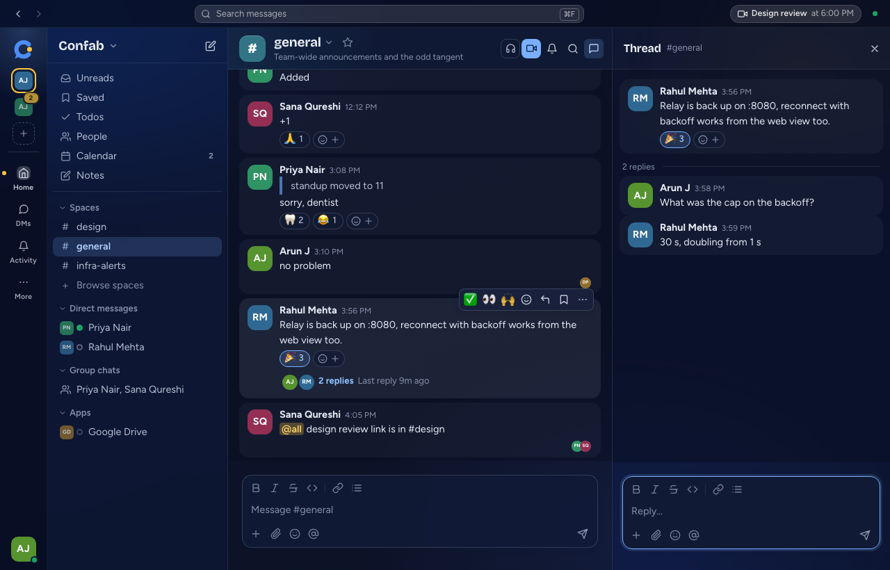
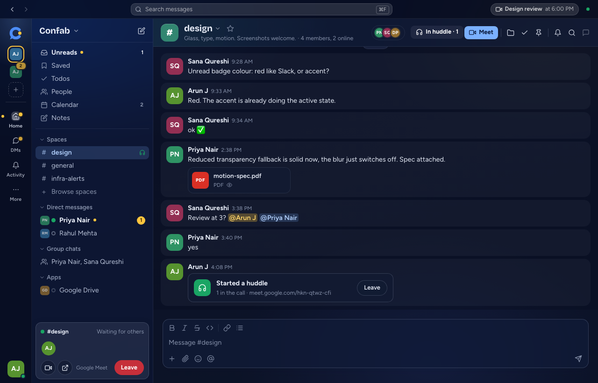
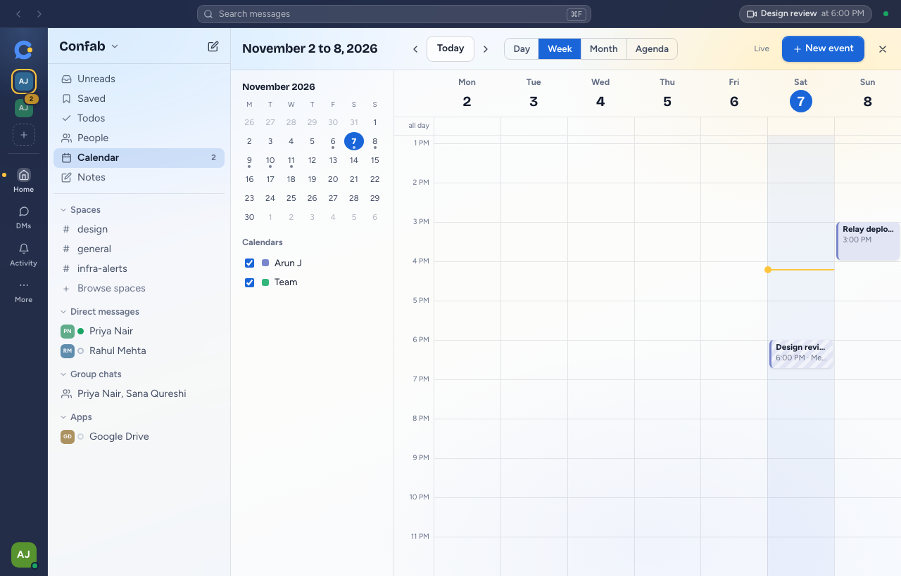
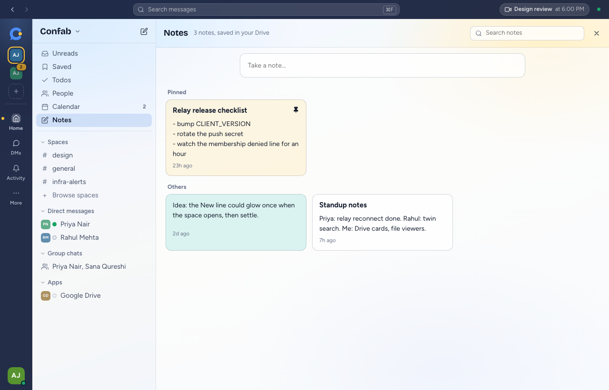

# Confab features: a desktop client for Google Chat

## Conversations

- Spaces, direct messages and group chats in one sidebar
- Threads in a side panel
- Messages from the same person, within five minutes, grouped into one block
- Reactions, including your three most used on the hover toolbar
- Right-click a message to reply, save, mark unread, copy, edit or delete
- Right-click a sidebar row to star, mute, mark as read or copy its link
- A pencil on any sidebar row with an unsent draft
- Unreads and Saved views, with a jump back to the original message

## Writing

- Bold, italic, strikethrough, code, links and numbered lists
- `@` to mention someone and `:` for emoji shortcodes
- Paste a URL over selected words to link them
- Paste or drop files anywhere in the window
- Press `↑` in an empty composer to edit your last message

## Huddles and calls

Calls run in the real Google Meet, in a small window that stays on top. If you have a Chrome profile signed in to the same account, the call opens there, so you don't sign in again.

- **In a named space**, Confab creates the Meet and posts it to the space. Up to 20 members are notified.
- **In a direct message or group chat**, the Huddle button opens the conversation in Google Chat, because no public Google API can ring a person.
- **When someone else starts one**, you get a popup with Join and Decline for 40 seconds. Do not disturb and muted spaces don't ring.

If a Meet can't be created, Confab falls back to in-app voice, which only reaches other Confab users.

## Calendar

- Month, week, day and agenda views
- Create and edit events, with repeats, guests and Google Meet links
- Answer invites with Yes, Maybe or No
- The next meeting and a countdown in the top bar
- A notification ten minutes before each timed event

## Notes and tasks

- **Todos** is your default Google Tasks list. Any message can become a task.
- **Notes** are Confab's own, because Google Keep has no API for signed-in users. They are stored in a private app folder in your Google Drive, so they follow you to any Confab.

## Files

Files open inside the app without a download:

| Type | Preview |
| --- | --- |
| Images | Lightbox |
| PDF | Pages with zoom |
| Word | Paper-style page |
| Excel, CSV, ODS | Grid with sheet tabs |
| Zip | Browsable tree |
| Text and code | Line numbers |
| Video and audio | Built-in player |

Presentations have no preview yet and save to your computer. Google Drive files open in your browser.

## Accounts and status

- Keep several Google accounts side by side, each with its own unread badge
- Your status and do not disturb are sent to Google, so Gmail and Chat show the same thing

## Notifications and privacy

- System notifications are set to All, DMs and mentions, or Off
- Link previews are Off, Ask or Always. The default is Ask, because fetching a page shows that site your address

## What depends on other people using Confab

Google's API leaves out typing indicators, other people's online status and read receipts. Confab carries these through its relay, so you only see them from teammates who also use Confab.

Pins are stored on your device only, because Google has no pin API for user apps.
